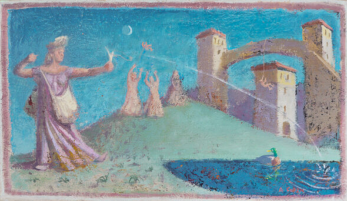

{fig-alt="\"Gravity\"" fig-align="left" width="670"}

Дорогие читатели!

Я начал переводить на русский язык стихи современных итальянских поэтов несколько лет назад. Первую подбор­ку переводов опубликовал в журнале «Семь Искусств» в 2020 году. Перевожу потому, что это приносит мне большую радость: выбор поэта, выбор каждого стихотворения на итальянском, создание подстрочника и много-этапный процесс его превращения в готовое стихотворение на русском. А перевожу именно с итальянского, потому что он очень красивый.

Большинство современных итальянских поэтов пишут белым стихом, без рифмы. Но это не значит, что в этих стихах отсутствует ритм — он есть, ритм музыкальный, ритм содержания, ритм эмоций. Я надеюсь, что и в моих переводах вы это тоже почувствуете.

Я расположил переводы по возрасту поэтов, начав с самых старших, родившихся в конце 19­го века, и закончив самыми молодыми, родившимся в конце 20­го.

Пользуюсь возможностью выразить искреннюю признательность моим жене и сыну, Ирине и Льву Фейгиным, за их большую помощь в создании этой книги.

*Александр Фейгин*

PS. Вы можете связаться со мной по [электронной почте](mailto:feiginy@aol.com) или в [Facebook](https://www.facebook.com/alexander.feigin.1).
